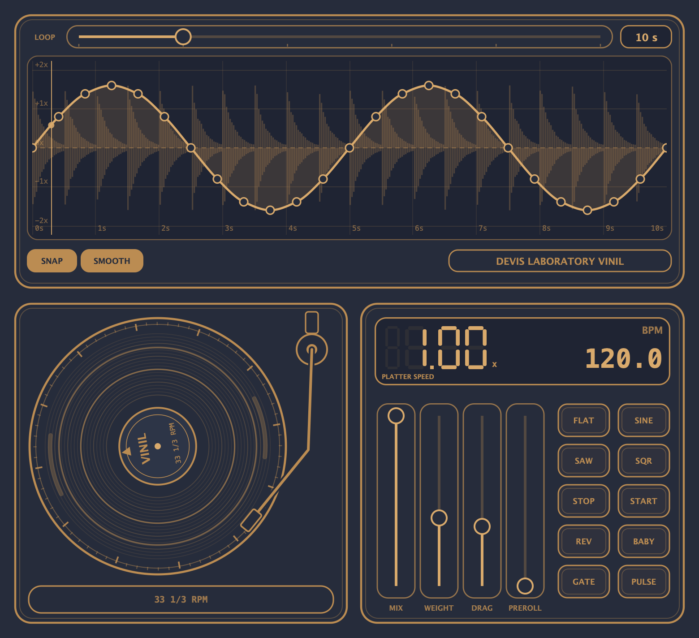

# Devis Laboratory Vinil

A VST3 scratch plugin built with JUCE. Put it on an audio track in Ableton Live: grab the record and scratch it, or draw a playback-speed curve over a loop of the incoming audio.



## What it does

The plugin keeps a window of the signal that goes through it (5 to 30 s) and lets you reshape the playback speed of that window.

- **Speed curve** – the top panel shows the waveform of the last loop and a curve on top of it. The X axis is time inside the loop, the Y axis is playback speed from −2× (reverse) through 0 (stop) to +2×. The loop is locked to the project tempo and position.
- **Turntable** – grab the record with the mouse and move it around the centre, like a real DJ. Let go and the platter returns to normal speed and plays on from where it is; the loop restart puts it back in time.
- **Pads** – ready-made curve shapes: FLAT, SINE, SAW, SQR, STOP, START, REV, BABY, GATE, PULSE.

## Controls

| Control | What it does |
|---|---|
| **LOOP** | Length of the window, 5–30 s in 1 s steps |
| **Curve** | Click to add a point, drag to move, right-click for a menu (delete point / add point / reset to flat), Alt-click deletes, Shift ignores snapping |
| **SNAP** | Points jump to steps of 0.5 s in time and 0.25× in speed |
| **SMOOTH** | Spline between points, or straight lines |
| **MIX** | Dry / wet |
| **WEIGHT** | How heavy the record feels under your hand (low = follows the mouse instantly, high = lazy and smooth) |
| **DRAG** | Inertia of the platter when it follows the curve |
| **PREROLL** | How far behind live the head restarts each loop, so the curve can also speed up |

Double-click a slider to reset it. The LCD shows the current platter speed and the project BPM.

## How it works

- The input is written into a circular buffer; the read head moves with a variable step (the curve value or the mouse), so the audio can slow down, stop and run backwards.
- 4-point Hermite interpolation for the fractional read position, and a short cross-fade whenever the head jumps (loop restart), so there are no clicks.
- A record held still reads one sample, which is faded to silence instead of a DC step.

## Build (macOS)

```bash
git clone --depth 1 --branch 8.0.8 https://github.com/juce-framework/JUCE.git JUCE
cmake -B build -DCMAKE_BUILD_TYPE=Release
cmake --build build --target DevisVinil_VST3
cp -R "build/DevisVinil_artefacts/Release/VST3/Devis Vinil.vst3" ~/Library/Audio/Plug-Ins/VST3/
```

Then rescan plug-ins in Ableton (Preferences → Plug-ins).

## Tests

An offline DSP test checks for clicks, NaN, direction, the curve, the loop window and the saved state:

```bash
cmake -B build-test -DVINIL_BUILD_TESTS=ON -DCMAKE_OSX_ARCHITECTURES=arm64
cmake --build build-test --target VinilTest
./build-test/VinilTest_artefacts/Release/VinilTest
# render the UI to a PNG
./build-test/VinilTest_artefacts/Release/VinilTest --snapshot docs/screenshot.png
```
